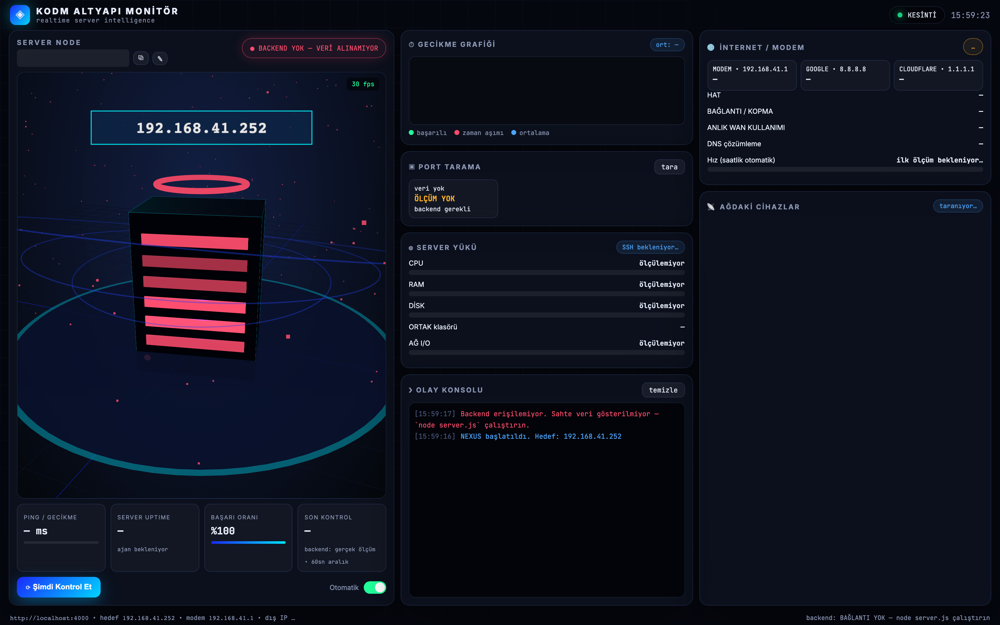

# KODM Infrastructure Monitor

> A kiosk-style, real-time network and server dashboard built with Three.js — every number is a real measurement, never demo data.

[](https://threejs.org/)
[](https://nodejs.org/)
[](https://www.docker.com/)
[](LICENSE)

<p align="center">
  <a href="https://www.buymeacoffee.com/cmtrkr"></a>
</p>

KODM Infrastructure Monitor is a single-screen dashboard for a small local network: a Windows server, a Tenda access point, a modem, internet health and every device seen on the LAN. It is designed for a TV or wall display with no scrolling, and it explains itself through a live Three.js scene: each thread reaching the server represents an **actual active connection**, colored by device type.

There is no mock mode. If the backend is unreachable, the dashboard says so instead of inventing numbers.

## 📸 Screenshot

<p align="center">
  
  <br>
  <sub>A real capture of the dashboard running without its backend. The empty cards and “BACKEND YOK” badge are the app's honest disconnected state — it never fabricates measurements.</sub>
</p>

## 📡 What it monitors

| Target | Data | Method |
| --- | --- | --- |
| `192.168.41.252` (server2, Windows) | ping, ports (445/139/3389/80/443/22/8080), CPU/RAM/disk, active TCP connections, SMB sessions and open files | ping + TCP scan + server2 agent |
| `192.168.41.1` (modem) + internet | modem ping, Google/Cloudflare ping and loss %, DNS time, external IP, hourly speed test | backend measurements |
| AP `192.168.41.210` (Tenda) | wired/wireless client lists (35+ devices) | AP web interface login |
| LAN devices | IP/MAC/vendor, ping, type color (🔴 infrastructure • 🔵 wireless • 🟠 wired) | ARP scan + AP + MAC OUI |

The 3D scene draws the server node, network rings and device threads. The event console records checks and failures; the latency chart keeps a rolling history.

## ✨ Features

- 🖥️ **No-scroll kiosk layout** — three columns, fixed viewport, large typography.
- 🌐 **Three.js scene** — live connection threads and device nodes.
- 📈 **Latency chart** — successful, timeout and average series.
- 🔌 **Port monitor** — SMB, RDP, HTTP(S), SSH and more.
- 🖧 **Device discovery** — ARP + AP client lists + MAC vendor lookup.
- 🪟 **Windows agent** — SMB sessions, open files, system load and TCP connections.
- 🐳 **Docker and Portainer ready** — compose file with `NET_RAW` for ping.
- 🔍 **Honest states** — explicit “backend unavailable” instead of fake values.
- ⏱️ **Measurement intervals** — server 60 s, internet 15 s, speed test hourly, device scan 60 s, shares 60 s.

## 🚀 Run

```bash
git clone https://github.com/cmtrkr83/yerel-agda-server-bilgileri-threejs.git
cd yerel-agda-server-bilgileri-threejs
npm install

cp .env.example .env    # fill in AP and server credentials
AP_PASS=<ap-password> node server.js
# open http://localhost:4000  (if busy: PORT=4001 node server.js)
```

### Environment variables

| Variable | Default | Purpose |
| --- | --- | --- |
| `PORT` | `4000` | Backend port |
| `AP_PASS` | — | Tenda AP admin password (wired/wireless split) |
| `AP_IP` | `192.168.41.210` | Access point address |
| `MODEM_IP` | `192.168.41.1` | Modem address |
| `SUBNET` | `192.168.41` | Scanned subnet |
| `SSH_USER` / `SSH_PASS` / `SSH_KEY_PATH` | — | Linux target system load (port 22) |
| `SERVER2_URL` | `http://192.168.41.252:9419/smb` | Windows agent endpoint |

The defaults describe the original network. Change them for yours.

## 🪟 Windows agent

`agent-server2.ps1` runs on the Windows server and publishes SMB sessions, open files, system load and TCP connections:

```powershell
# Copy to C:\kodm\agent-server2.ps1, then as administrator:
schtasks /create /tn "KODM Agent" /tr "powershell -WindowStyle Hidden -ExecutionPolicy Bypass -File C:\kodm\agent-server2.ps1" /sc onstart /ru SYSTEM /rl highest /f
schtasks /run /tn "KODM Agent"
```

Test: `http://127.0.0.1:9419/smb`

## 🐳 Docker / Portainer

```bash
cp .env.example .env
docker compose up -d --build
# open http://<host>:4000
```

- `cap_add: [NET_RAW]` is required for ping.
- ARP and mDNS/SSDP discovery need the container to see the LAN. On a Linux host (for example a Portainer host at `192.168.41.119`), enable `network_mode: host`.
- In bridge mode, ping/ports/modem/AP still work; ARP-based discovery is limited, but the AP and modem lists still populate devices.
- The compose file exposes the app on port 4000.

## 📁 Project structure

```text
├── index.html              # Dashboard markup
├── style.css               # Kiosk layout and theme
├── main.js                 # Three.js scene + frontend data loop
├── server.js               # Ping, ports, SSH, AP, internet, speed test, scans
├── agent-server2.ps1       # Windows SMB/system agent
├── oui-cache.json          # MAC vendor cache
├── Dockerfile
├── docker-compose.yml
└── .env.example
```

## ⚠️ Notes

- Run it on the same LAN as the devices you want to measure.
- The dashboard is read-only; it does not change router or server configuration.
- Credentials live in `.env`, which is excluded from Git. Never commit real passwords.
- The screenshot above intentionally shows the disconnected state; connect the backend to populate every card with live values.

## ❤️ Support

If this dashboard is useful to you, you can buy me a coffee:

<p align="center">
  <a href="https://www.buymeacoffee.com/cmtrkr"></a>
</p>

## 📄 License

[MIT](LICENSE) © 2026 Cem Türker.
